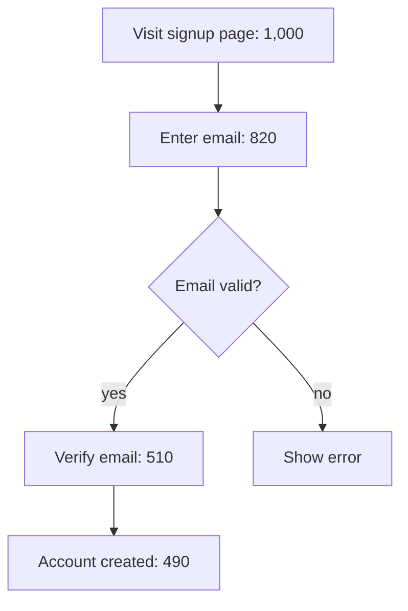
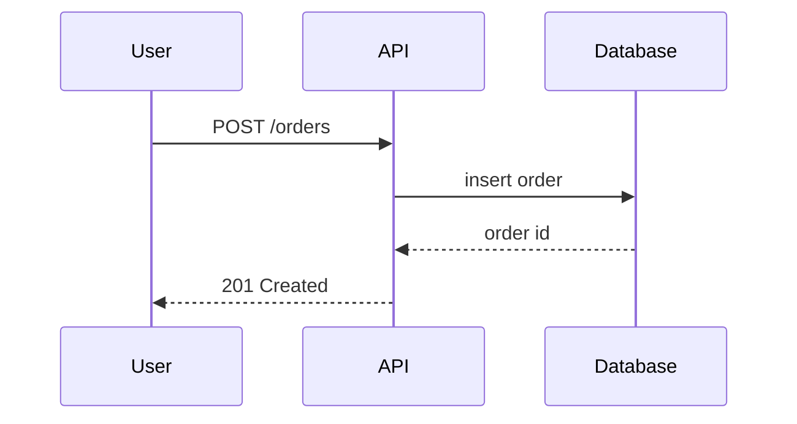
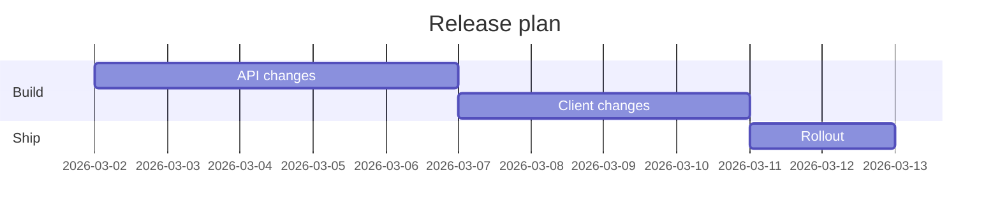

# Markdown outputs

Read this when the result is read where Markdown renders and a script does not: a pull request, a README, a ticket, a wiki page, a chat message.

## Pick the form

| Reader's question | Form | Renders |
| --- | --- | --- |
| What are the exact values, side by side? | Table | everywhere tables render |
| Which is larger, at a glance? | Text bars with the values | any monospace block |
| What ranks where, and how did it move? | Ranked list | everywhere |
| How do the steps and decisions connect? | Mermaid `flowchart` | where Mermaid renders |
| Who sends what to whom, in what order? | Mermaid `sequenceDiagram` | where Mermaid renders |
| What runs when, and what waits on what? | Mermaid `gantt` | where Mermaid renders |
| What contains what? | Indented tree | any monospace block |

Mermaid renders in GitHub, GitLab, Notion, and Obsidian. Slack, email, Confluence, and plain ticket fields show it as raw text.
Where the surface is one of those, or unknown, use a tree, a list, or a table in place of a diagram.

## Every form

- Open with a heading or a bold line that states the claim.
- Put the unit in each column header or after each value.
- Close with one line naming the source and the period.
- For text bars and diagrams that carry numbers, add a table of the exact values beneath.

## Table

Right-align numeric columns and sort by the compared value, or by time where the rows are a sequence.

```markdown
| Channel  | Weekly signups | Change vs last week |
| -------- | -------------: | ------------------: |
| Search   |          1,284 |                +112 |
| Direct   |            630 |                 -18 |
```

## Text bars

Draw each bar in proportion to its value from zero: pick the longest bar's length, then give each row `value / largest × longest` blocks, rounded.
Start every bar in the same column and print the value with its unit after it.

````markdown
```
Search    ████████████████████  1,284 signups
Direct    ██████████              630 signups
Referral  ███████                 470 signups
Social    █████                   310 signups
```
````

Mark the one or two rows the claim is about with a short note after the value.

## Ranked list

```markdown
1. **Search**: 1,284 signups (+112)
2. **Direct**: 630 signups (-18)
3. **Referral**: 470 signups (+4)
```

## Mermaid

Keep node labels short, one idea per node, and put counts in the label where the diagram is about quantities.

````markdown

````

````markdown

````

````markdown

````

## Indented tree

```
checkout/
├── cart/          3 screens
├── payment/       5 screens
│   └── wallets/   2 screens
└── confirmation/  1 screen
```

## Check

Run `scripts/check_output.py` on the `.md` file. It reports a Mermaid block with an unknown diagram type or unbalanced brackets, a table with ragged rows, and a text bar out of proportion to its value.
